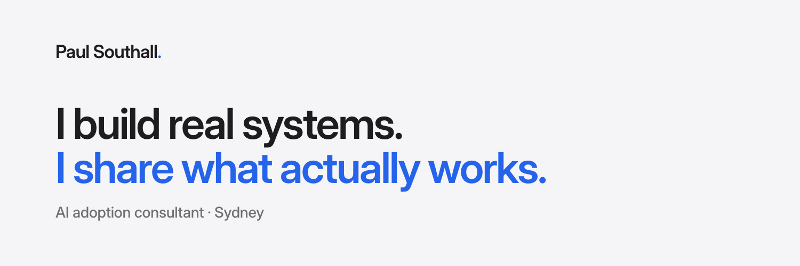
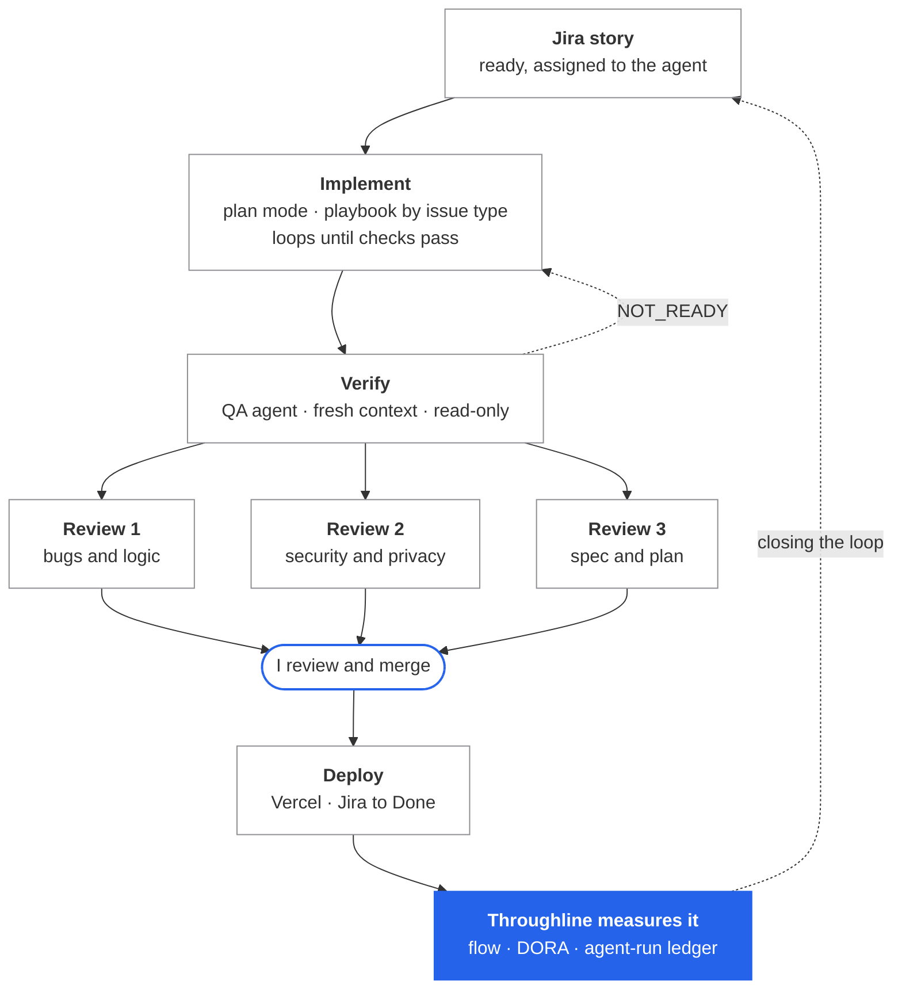
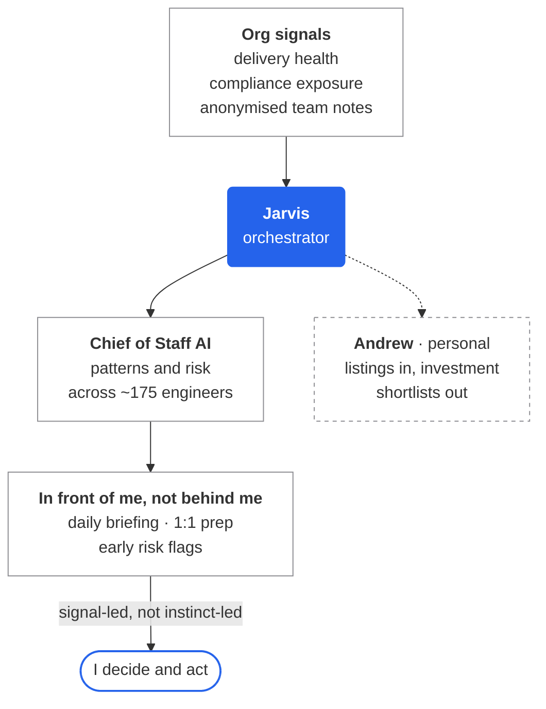

<picture>
  <source media="(prefers-color-scheme: dark)" srcset="github-header-dark.png">
  
</picture>

---

### About Me

AI adoption consultant in Sydney. Engineering leader. Operator.

I lead a globally distributed team of ~175 engineers and architecture building high-performance platforms in fintech and trading where uptime and performance is non-negotiable.

AI-native decision making sits at the core of how I operate - keeping people risk, delivery health and compliance exposure in front of me, not behind me.

I build real systems. I share what actually works.

Currently **Global Head of Architecture & Engineering at FDJ**.

---

### AI Systems I've Built

| System | What it does | Impact |
|---|---|---|
| **Throughline** | Engineering intelligence for teams of humans and agents: flow and DORA metrics, working agreements and an agent-run ledger. Built by the agent pipeline it measures, with 7 agent roles and 21 Claude skills | 6 of 15 merged pull requests came from the unattended pipeline, every one behind my merge (Oct 2026) |
| **Jarvis** | AI orchestrator - the backbone of how I run my organisation | Shifted from instinct-led to signal-led leadership at scale |
| **Chief of Staff AI** | Weekly Pulse skill: turns anonymised voice notes into a leadership read across ~175 engineers | Earlier risk detection, better 1:1s, more proactive leadership |
| **Engineering Health Companion** | Weekly engineering health from GitLab: deterministic metrics, a Claude-written narrative and follow-up questions | Every number is checked against tool output, and names are pseudonymised before data leaves the laptop |
| **AI-governed software factory** | Five role-separated agents (spec, architect, dev, QA, security) with a human approval gate between every stage | A tamper-evident audit trail from intent to release |
| **Corporate Bingo** | Real-time multiplayer buzzword bingo, built as a vehicle for end-to-end AI orchestration. A requirements skill turns a plain-English brief into a ready GitHub issue | Live on Vercel |
| **Peckish** | A Claude skill plus an MCP server: photo of the fridge in, three dinners you can make tonight out | Built in public, weekend by weekend |
| **CornealScope** | Webcam computer vision that tracks how a ring pattern reflected off the cornea distorts over time, the shape change keratoconus causes. Runs entirely in the browser, with no data leaving the device | Scoring validated against synthetic eyes with known distortion. An engineering demo, not a medical device |
| **Morning brief** | Claude skill that renders my day as one page, on a weekday schedule | One read before the first meeting |
| **Andrew** | Property investment bot - shortlists and evaluates listings against personal investment goals | Replaced hours of manual weekend research with automated recommendations |

---

### How I build: loop engineering

Throughline is built by the loop it measures. Agents plan, build, verify and review; three separate review passes check for bugs, security and the spec; only I merge.

---

### How I lead: signals in front of me

---

### Where I share

Practical AI for leaders in the missing middle, between beginner tips and advanced builds: real systems, honest experiments and the simple stuff first.

[LinkedIn](https://www.linkedin.com/in/pauliosouthall/) · [psouthall.com](https://psouthall.com)

---

### AI Stack

Tools I actually use to operate:

---

### Technologies I've Led at Scale

  &nbsp;
  &nbsp;
  &nbsp;
  &nbsp;
  &nbsp;
  &nbsp;
  &nbsp;
  &nbsp;
  &nbsp;
  &nbsp;
  &nbsp;
  &nbsp;
  &nbsp;
  &nbsp;
  &nbsp;
  &nbsp;
  

#### Building with now

  &nbsp;
  &nbsp;
  &nbsp;
  &nbsp;
  &nbsp;
  &nbsp;
  &nbsp;
  

---

### GitHub Stats

